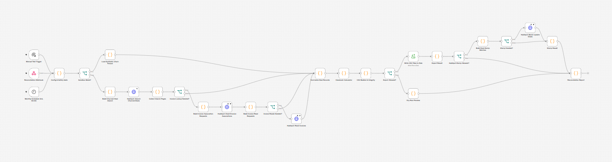

# n8n-hubspot-commission-clawback-churn-reconciliation-calculator

> Tracks early customer churn inside a defined 90-day clawback window, computes prorated Account Executive (AE) and Sales Development Representative (SDR) commission adjustments, and exports an auditable payroll reconciliation CSV.

Once a month (or on demand), this n8n workflow does the following:

1. **Finds churned deals** in HubSpot for a reconciliation period. A deal counts as churned if its `churn_date` falls in the period, or if it moved from closed-won to closed-lost during the period.
2. **Measures days active** from the contract start (falling back to the closed-won date, then the close date) to the churn date, in UTC calendar days.
3. **Computes each clawback** for the AE and the SDR, using a linear, tiered or full policy. Money is calculated exactly in integer minor units, with FX conversion to the payroll currency.
4. **Writes three files**: a payroll CSV of adjustments, an audit CSV covering every deal evaluated, and a manifest. Each carries a SHA-256 checksum.
5. **Stamps each reconciled deal** with a reconciliation ID, but only after the export succeeds, so no deal is ever clawed back twice.

It is **safe by default**. Imported as-is, it runs against a synthetic fixture (portal `99000001`): zero API calls, zero files written, zero CRM updates. The CSVs appear only as **DRAFT** binaries inside the n8n execution.

---

## Contents

1. [Architecture overview](#1-architecture-overview)
2. [Prerequisites](#2-prerequisites)
3. [5-minute sandbox quick start](#3-5-minute-sandbox-quick-start)
4. [Step-by-step setup and go-live](#4-step-by-step-setup-and-go-live)
5. [Environment variables](#5-environment-variables)
6. [Clawback logic](#6-clawback-logic)
7. [Output files](#7-output-files)
8. [Safety and fail-closed matrix](#8-safety-and-fail-closed-matrix)
9. [Compliance checklist](#9-compliance-checklist)
10. [Troubleshooting](#10-troubleshooting)
11. [Repository layout](#11-repository-layout)
12. [Disclaimer and license](#12-disclaimer--liability-limitation)

---

## 1. Architecture overview

```mermaid
flowchart LR
    subgraph T["Triggers"]
        MT["Manual Test Trigger"]
        WH["Reconciliation Webhook<br/>POST {period}, secret"]
        SC["Monthly Schedule<br/>3rd of month"]
    end
    MT --> C
    WH --> C
    SC --> C
    C["Config & Safety Gate<br/>env only, fail-safe flags,<br/>period, webhook auth"] --> SB{"Sandbox Mode?"}
    SB -- "true (default)" --> FX["Load Synthetic<br/>Churn Fixture"]
    SB -- false --> BS["Build Churned-Deal Search<br/>churn_date OR closed-lost"]
    BS --> HS["HubSpot: Search Churned Deals<br/>200/page, paginated, read-only"]
    HS --> CS["Collect Search Pages<br/>FAIL CLOSED: errors, >10k, truncation"]
    CS --> IL{"Invoice Lookup Needed?"}
    IL -- true --> BA["Build Invoice Association<br/>Requests"] --> HA["HubSpot: Deal→Invoice<br/>Associations (v4)"] --> BI["Build Invoice<br/>Read Requests"] --> IR{"Invoice Reads Needed?"}
    IR -- true --> RI["HubSpot: Read Invoices"] --> N
    IR -- false --> N
    IL -- false --> N
    FX --> N["Normalize Deal Records"]
    N --> K["Clawback Calculator<br/>window, policy, BigInt money,<br/>FX, holds, guards"]
    K --> V["CSV Builder & Integrity<br/>payroll + audit + manifest,<br/>SHA-256, injection guard"]
    V --> EA{"Export Allowed?<br/>config AND guards"}
    EA -- "false (default)" --> DR["Dry-Run Preview<br/>DRAFT files + blockers"]
    EA -- true --> WF["Write CSV Files to Disk"] --> ER["Export Result<br/>3/3 written or stop"]
    ER --> SA{"HubSpot Stamp Allowed?"}
    SA -- true --> BB["Build Deal Stamp Batches"] --> SN{"Stamp Needed?"}
    SN -- true --> BU["HubSpot: Batch Update Deals<br/>the ONLY CRM write"] --> SR["Stamp Result"]
    SN -- false --> SR
    SA -- false --> R
    SR --> R
    DR --> R["Reconciliation Report"]
```





### Design principles

| Principle | Implementation |
|---|---|
| **Fail closed on data** | A failed search page, more than 10,000 matches (HubSpot's search ceiling) or truncated pagination **stops the run** before any file is built. A payroll file built from partial data would be wrong without anyone knowing. |
| **Fail closed on money** | Pending-review deals, missing `FX_RATES_AS_OF`, `MAX_TOTAL_CLAWBACK` / `MAX_SINGLE_ADJUSTMENT` breaches and config errors **block the export**. Only DRAFT files are produced. |
| **Exact arithmetic** | Amounts are parsed strictly into BigInt minor units. Rates and FX are exact fractions, with one half-up rounding per step. No floating-point amount is ever summed. |
| **Export before stamp** | Deals are stamped only after all three files are written. If the write fails, the run stops and nothing is stamped. |
| **Whole-deal holds** | If one role on a deal needs review, the other role's valid adjustment is **held** too, so a re-run can't pay it twice. |
| **Deterministic IDs** | `adjustment_id` is a hash of period, deal, role and rep, and `reconciliation_id` is a hash of the result set. Payroll can dedupe even if a file is imported twice. |
| **One CRM write node** | Only *HubSpot: Batch Update Deals* writes. Every other HubSpot call is a search or a batch read. |

---

## 2. Prerequisites

- **n8n** 1.x or later, with:
  - `N8N_BLOCK_ENV_ACCESS_IN_NODE=false`. If env access is blocked, the workflow falls back to sandbox defaults instead of failing open.
  - `N8N_RESTRICT_FILE_ACCESS_TO` including `CSV_EXPORT_DIR`. Without it, n8n refuses the write ("Access to the file is not allowed."), and the run stops before any deal is stamped. Verified on n8n 2.47.7.
- **Node.js 18+** to run the offline simulator. It has no dependencies.
- A **HubSpot private app** in a developer test account or sandbox portal first.
- **Commission records in HubSpot**: the AE and SDR commission that was actually paid, recorded per deal. This workflow claws back what was *paid*; it doesn't recalculate your commission plan. A computed fallback exists, but it is off by default.

### HubSpot private app scopes

| Scope | Used for |
|---|---|
| `crm.objects.deals.read` | Deal search (`POST /crm/v3/objects/deals/search`) and deal → invoice association reads |
| `crm.objects.deals.write` | The reconciliation stamp (`POST /crm/v3/objects/deals/batch/update`), only when `HUBSPOT_MUTATIONS_ENABLED=true` |
| `crm.objects.invoices.read` | Invoice batch reads, used for collected-cash retention and audit. Optional: set `INVOICE_COLLECTION_ENABLED=false` if you don't use HubSpot invoices. |

### Custom deal properties

Create these properties under **Settings → Properties → Deal properties**, in a group such as *Commission Clawback*. Restrict editing to RevOps and Finance.

| Internal name | Type | Read / written | Purpose |
|---|---|---|---|
| `churn_date` | Date picker | read | Date the customer churned (set by CS, billing sync or another workflow) |
| `contract_start_date` | Date picker | read | Window anchor. If empty, closed-won entry date, then close date. |
| `sdr_owner_id` | HubSpot user | read | SDR credited on the deal |
| `ae_commission_paid` | Number | read | AE commission actually paid, in deal currency |
| `sdr_commission_paid` | Number | read | SDR commission actually paid, in deal currency |
| `clawback_exempt` | Single checkbox | read | Approved exception: never claw back |
| `clawback_status` | Single-line text | written | `CLAWBACK`, `NO_CLAWBACK_DUE`, `OUTSIDE_WINDOW` or `EXEMPT` |
| `clawback_ae_amount` / `clawback_sdr_amount` | Number | written | Clawback magnitude in payroll currency |
| `clawback_reconciliation_id` | Single-line text | written | **Idempotency key.** Deals with a value here are skipped. |
| `clawback_processed_at` | Date picker (datetime) | written | When the deal was reconciled |

The closed-lost churn signal uses HubSpot's built-in `hs_date_entered_<stageId>` properties (for example `hs_date_entered_closedwon` and `hs_date_entered_closedlost`). Custom pipelines use numeric stage IDs, so set `CLOSED_WON_STAGE` and `CLOSED_LOST_STAGE` to match.

---

## 3. 5-minute sandbox quick start

**Step 1. Run the offline simulator (about 1 second, no n8n, no network).**

```bash
git clone <your-private-copy-of-this-repo>
cd n8n-hubspot-commission-clawback-churn-reconciliation-calculator
node scripts/simulate-sandbox-run.js
```

The simulator only loads `fs`, `path` and `vm`. It contains a small n8n-style engine that follows `workflow.json`'s connections, runs every Code node verbatim, evaluates expressions, emulates HTTP pagination and the file-write node, and routes HTTP calls to an in-memory HubSpot that **really evaluates the search filters**. Its 140 checks cover structure and static safety, safe defaults, config validation, webhook auth, exact money and date parsing, all 16 fixture scenarios against an independent reference calculation, every policy option and guard, CSV correctness and checksums, pagination across 450 deals, the fail-closed limits, export → stamp ordering, and idempotency. It ends with:

```
✅ 140 passed, 0 failed
Sandbox total clawback: -18896.71 USD across 11 adjustments (REC-2026-10-0F4465FC7F)
```

`sim-output/` contains the DRAFT payroll CSV, audit CSV and manifest, plus reports from the sandbox and mocked live runs.

**Step 2. Import into n8n.** Go to **Workflows → Import from File** and select `workflow.json`. No credentials are needed.

**Step 3. Execute.** Click **Test workflow**. The 16 synthetic deals for period `2026-10` produce:

| Deal | Scenario | Result |
|---|---|---|
| 990010001 | Churn day 21, AE + SDR | `CLAWBACK` AE −7,283.33 · SDR −1,456.67 (linear 69/90) |
| 990010002 | Churn day 60, deal name is `=HYPERLINK(...)` | `CLAWBACK` −2,000.00, and the name is neutralised if exported |
| 990010003 | Churn day 89 | `CLAWBACK` AE −50.00 · SDR −10.00 (1/90) |
| 990010004 | Churn day 90 (inclusive) | `NO_CLAWBACK_DUE`: linear rate 0, below de minimis |
| 990010005 | Churn day 141 | `OUTSIDE_WINDOW` |
| 990010006 | EUR deal, day 45 | `CLAWBACK` AE −3,888.00 · SDR −777.60 (€ × 1.08 × ½) |
| 990010007 | JPY deal (zero decimals), day 10 | `CLAWBACK` −1,786.67 |
| 990010008 | CHF deal, no FX rate | `PENDING_REVIEW` `FX_RATE_MISSING` |
| 990010009 | Closed-won → closed-lost, no `churn_date` | `CLAWBACK` AE −1,222.22 · SDR −244.44 (day 46) |
| 990010010 | `clawback_exempt=true` | `EXEMPT` |
| 990010011 | Already has a reconciliation ID | `SKIP_ALREADY_RECONCILED` |
| 990010012 | Commission `"9,5OO"` | `PENDING_REVIEW` `INVALID_COMMISSION_AMOUNT` |
| 990010013 | Churn before contract start | `PENDING_REVIEW` `CHURN_BEFORE_ANCHOR` |
| 990010014 | No AE owner | `PENDING_REVIEW` `MISSING_AE_OWNER` |
| 990010015 | AE paid 0, SDR paid 400, epoch-ms start date | AE `NO_COMMISSION_PAID` · SDR −177.78 |
| 990010016 | SDR commission missing | `PENDING_REVIEW`. The valid AE −3,066.67 is **held**. |

Because 5 deals need review, the export is blocked. Open **Dry-Run Preview** for the blockers and the DRAFT payroll preview, and download the DRAFT files from the **CSV Builder & Integrity** node's binary tab.

---

## 4. Step-by-step setup and go-live

Each stage changes one thing. Do all of them in a HubSpot test portal first.

### Stage A: live read, dry run

1. Create the private app and the custom properties ([§2](#2-prerequisites)). Load a few test deals.
2. Set:
   ```bash
   SANDBOX_MODE=false
   HUBSPOT_ACCESS_TOKEN=<from secret store>
   HUBSPOT_PORTAL_ID=<numeric test-portal ID>
   RECONCILIATION_PERIOD=2026-10
   FX_RATES=<finance-approved rates for the period>
   FX_RATES_AS_OF=2026-10-31
   ```
3. Restart n8n and run manually. Compare the DRAFT payroll CSV line by line against your commission ledger. Resolve every `PENDING_REVIEW` deal by fixing the data, or mark it exempt with approval.

### Stage B: export

1. Create the export directory on a volume only Finance and n8n can read, then allow n8n to write there:
   ```bash
   CSV_EXPORT_DIR=/home/node/.n8n-files/clawback-exports
   N8N_RESTRICT_FILE_ACCESS_TO=/home/node/.n8n-files/clawback-exports
   ```
2. Set `DRY_RUN=false` and `CSV_EXPORT_ENABLED=true`, then run. Verify the files with `sha256sum` against the manifest.

### Stage C: stamp (idempotency)

1. Set `HUBSPOT_MUTATIONS_ENABLED=true` and run again for a **new** period, or a test period. The report should show `EXPORTED_AND_STAMPED`.
2. Run the same period again. Every deal should come back `SKIP_ALREADY_RECONCILED`, with zero adjustments.

### Stage D: schedule

Activate the workflow. The **Monthly Schedule** runs on the 3rd at 04:23 (instance time zone) for the previous month, which leaves time for late churn updates. Configure an n8n **Error Workflow** so a fail-closed abort alerts an owner.

### Webhook (optional, on demand)

```bash
curl -X POST "https://<your-n8n>/webhook/hubspot-clawback-reconciliation" \
  -H "x-reconciliation-secret: $WEBHOOK_SHARED_SECRET" \
  -H "content-type: application/json" \
  -d '{"period":"2026-10"}'
```

Live webhooks fail closed without a valid secret. The secret is checked in the first Code node and never copied into item data. n8n's own execution history still stores the raw webhook input, so restrict who can view executions.

---

## 5. Environment variables

| Variable | Default | Description |
|---|---|---|
| `SANDBOX_MODE` | `true` | **Safe-ON.** Synthetic fixture and portal, zero network calls. Off only with `false`/`0`/`no`/`off`. |
| `DRY_RUN` | `true` | **Safe-ON.** DRAFT files only. |
| `CSV_EXPORT_ENABLED` | `false` | **Safe-OFF.** Write files to `CSV_EXPORT_DIR`. On only with `true`/`1`/`yes`/`on`. |
| `HUBSPOT_MUTATIONS_ENABLED` | `false` | **Safe-OFF.** Stamp reconciled deals. Also requires the export. |
| `BLOCK_EXPORT_ON_PENDING_REVIEW` | `true` | **Safe-ON.** Any deal under review blocks the whole export. |
| `RECONCILIATION_PERIOD` | previous month | `YYYY-MM`, UTC. Future periods are refused; a still-open period gives a warning. |
| `CLAWBACK_WINDOW_DAYS` | `90` | 1–730. |
| `CLAWBACK_WINDOW_INCLUSIVE` | `true` | Whether day 90 counts as inside the window. |
| `CLAWBACK_WINDOW_ANCHOR` | `contract_start` | Or `close_date` (closed-won entry, then close date). |
| `CLAWBACK_POLICY` | `linear` | `linear`, `tiered` or `full`. |
| `CLAWBACK_TIERS` | `30:1,60:0.5,90:0.25` | For `tiered`: `maxDays:rate` pairs. |
| `CLAWBACK_RETAIN_COLLECTED_CASH` | `false` | Multiply the clawback by the unpaid share of the contract. |
| `CLAWBACK_MIN_AMOUNT` | `1.00` | De-minimis threshold in payroll currency. |
| `DETECT_CLOSED_LOST_CHURN` | `true` | Treat a closed-won → closed-lost move as churn. |
| `COMMISSION_SOURCE` | `recorded_only` | `recorded_then_computed` falls back to the rates below and flags those rows. |
| `AE_COMMISSION_RATE` / `SDR_COMMISSION_RATE` | `0.10` / `0.02` | Used only by the computed fallback. |
| `PAYROLL_CURRENCY` | `USD` | ISO code of the payroll file. |
| `PORTAL_DEFAULT_CURRENCY` | `USD` | Used when `deal_currency_code` is empty. |
| `FX_RATES` | — | `CCY:rate,…`: units of payroll currency per 1 unit of the deal currency, up to 10 decimals. |
| `FX_RATES_AS_OF` | — | `YYYY-MM-DD`. Required whenever any conversion happens. |
| `MAX_TOTAL_CLAWBACK` | `50000` | Export blocked above this total. |
| `MAX_SINGLE_ADJUSTMENT` | `15000` | Export blocked if any single adjustment exceeds this. |
| `REQUIRE_PAYROLL_REF` | `false` | `true` sends reps without a payroll reference to review. |
| `REP_PAYROLL_REF_MAP` | — | `ownerId:REF,…`. Keep real mappings in your secret store. |
| `HUBSPOT_ACCESS_TOKEN` | — | Private app token. Required in live mode. |
| `HUBSPOT_PORTAL_ID` | — | Numeric. Required in live mode; forced to `99000001` in sandbox. |
| `HUBSPOT_API_BASE_URL` | `https://api.hubapi.com` | API host. |
| `HUBSPOT_SEARCH_PAGE_SIZE` | `200` | 10–200 (HubSpot's maximum is 200). |
| `INVOICE_COLLECTION_ENABLED` | `true` | Read associated invoices. |
| `CLOSED_WON_STAGE` / `CLOSED_LOST_STAGE` | `closedwon` / `closedlost` | Stage IDs; numeric for custom pipelines. |
| `*_PROPERTY` | see `.env.example` | Names of the properties read and stamped. |
| `CSV_EXPORT_DIR` | `/home/node/.n8n-files/clawback-exports` | Must be inside `N8N_RESTRICT_FILE_ACCESS_TO`. |
| `CSV_INCLUDE_DEAL_NAME` | `false` | Deal names often carry customer names, so they're off by default. |
| `CSV_UTF8_BOM` | `false` | `true` helps Excel detect UTF-8. |
| `WEBHOOK_SHARED_SECRET` | — | 16+ characters. Required for live webhooks. |
| `NOW_OVERRIDE` | — | Pins "now" for reproducible tests. |

### Sample `.env`

```bash
# Stage A: live read-only reconciliation of a TEST portal, DRAFT output only
N8N_BLOCK_ENV_ACCESS_IN_NODE=false
N8N_RESTRICT_FILE_ACCESS_TO=/home/node/.n8n-files/clawback-exports
SANDBOX_MODE=false
DRY_RUN=true
CSV_EXPORT_ENABLED=false
HUBSPOT_MUTATIONS_ENABLED=false

HUBSPOT_ACCESS_TOKEN=<injected-from-secret-manager>
HUBSPOT_PORTAL_ID=99000001
RECONCILIATION_PERIOD=2026-10

CLAWBACK_WINDOW_DAYS=90
CLAWBACK_POLICY=linear
PAYROLL_CURRENCY=USD
FX_RATES=EUR:1.08,GBP:1.27,JPY:0.0067
FX_RATES_AS_OF=2026-10-31
REP_PAYROLL_REF_MAP=99100001:EMP-SYN-0001,99200001:EMP-SYN-0101
```

The FX rates above are placeholders; use rates your finance team has approved for the period. The complete template is in [`.env.example`](.env.example).

---

## 6. Clawback logic

### 6.1 Which deals are evaluated

The live search uses up to two OR'ed filter groups. HubSpot allows at most five groups and 18 filters in total.

| Group | Filters |
|---|---|
| A: explicit churn | `churn_date ≥ periodStart` AND `churn_date < periodEnd` |
| B: closed-lost churn | `dealstage = closedlost` AND `hs_date_entered_closedlost` in the period AND `hs_date_entered_closedwon` has a value |

Results are sorted by `hs_object_id` and fetched 200 per page with the `after` cursor, up to 50 pages (10,000 results). The calculator re-checks the period, so a mis-filtered record can never slip through.

### 6.2 Decision order per deal

| # | Check | Outcome |
|---|---|---|
| 1 | `clawback_reconciliation_id` already set | `SKIP_ALREADY_RECONCILED` |
| 2 | `clawback_exempt` true | `EXEMPT` |
| 3 | `churn_date` present but malformed | `PENDING_REVIEW` `INVALID_CHURN_DATE` |
| 4 | No churn signal | `NOT_CHURNED` |
| 5 | Churn outside the period, or in the future | `OUT_OF_PERIOD` / `NOT_YET_EFFECTIVE` |
| 6 | Anchor: contract start → closed-won entry → close date | `PENDING_REVIEW` `MISSING_ANCHOR_DATE` / `INVALID_CONTRACT_START` |
| 7 | `daysActive = churnDay − anchorDay` < 0 | `PENDING_REVIEW` `CHURN_BEFORE_ANCHOR` |
| 8 | Outside the window (`> 90`, or `≥ 90` when exclusive) | `OUTSIDE_WINDOW` |
| 9 | For each role (AE always; SDR when `sdr_owner_id` is set): owner, FX, commission and amount checks | Row `CLAWBACK`, `BELOW_DE_MINIMIS`, `NO_COMMISSION_PAID` or `PENDING_REVIEW` |
| 10 | Any row pending | Deal `PENDING_REVIEW`, and every other row is set to `HELD_DEAL_PENDING_REVIEW` |

Dates are accepted as `YYYY-MM-DD`, ISO datetimes or epoch milliseconds. Impossible dates such as `2026-02-30`, and anything outside 1990–2100, are rejected. All day arithmetic uses UTC calendar days.

### 6.3 Rate policies

With `d = daysActive` and `W = CLAWBACK_WINDOW_DAYS`:

| Policy | Rate | Day 21 | Day 60 | Day 89 | Day 90 |
|---|---|---|---|---|---|
| `linear` (default) | `(W − d) / W` | 76.67% | 33.33% | 1.11% | 0% |
| `tiered` (`30:1,60:0.5,90:0.25`) | first tier with `d ≤ maxDays` | 100% | 50% | 25% | 25% |
| `full` | 100% inside the window | 100% | 100% | 100% | 100% (inclusive) |

### 6.4 Amount calculation

```
commission_deal   = recorded ae/sdr_commission_paid (strict decimal, deal currency)
commission_pay    = round_half_up( commission_deal × fx_rate )               → payroll currency
clawback          = round_half_up( commission_pay × rate × uncollected_share )
uncollected_share = 1, or (amount − collected) / amount when CLAWBACK_RETAIN_COLLECTED_CASH=true
```

- **Strict parsing**: `1234.56` and `1,234.56` are accepted. `9.500,00`, `12k`, `9,5OO` and negative values are rejected and go to `PENDING_REVIEW`. Nothing is guessed.
- **Exact maths**: rates and FX are exact fractions over BigInt minor units, so `2.675` rounds to `2.68`, not to `2.67` as floating point would. Zero-decimal (JPY, KRW and others) and three-decimal (KWD, BHD and others) currencies are handled.
- **Collected cash**: paid = billed − balance due for invoices that aren't voided or draft, in the deal currency. A missing invoice scope or a currency mismatch sends the row to review.
- **Sign**: clawbacks are **negative** in the payroll CSV. Stamped HubSpot amounts are magnitudes.
- **Commission recorded as 0** gives `NO_COMMISSION_PAID`. Anything under `CLAWBACK_MIN_AMOUNT` gives `BELOW_DE_MINIMIS`. Neither is paid, and both are visible in the audit CSV.

### 6.5 Guards (all block the export)

| Guard | Default |
|---|---|
| Any deal in `PENDING_REVIEW` | blocks (`BLOCK_EXPORT_ON_PENDING_REVIEW=true`) |
| Total clawback above `MAX_TOTAL_CLAWBACK` | 50,000 |
| Any adjustment above `MAX_SINGLE_ADJUSTMENT` | 15,000 |
| FX used but `FX_RATES_AS_OF` not set | always |
| Configuration errors (bad tiers, FX, numbers, window) | always |
| Incomplete collection | run aborts earlier |

---

## 7. Output files

| File | Contents |
|---|---|
| `clawback-<period>-<reconciliationId>-payroll.csv` | One row per `CLAWBACK` adjustment, ready to import |
| `clawback-<period>-<reconciliationId>-audit.csv` | Every evaluated deal and role row, with status and reason code |
| `clawback-<period>-<reconciliationId>-manifest.json` | Totals, per-rep totals, status counts, guards, FX snapshot, policy and per-file SHA-256 |

Files are prefixed `DRAFT-` whenever the export is blocked.

**Payroll CSV columns:** `reconciliation_id, adjustment_id, period, rep_role, rep_hubspot_owner_id, rep_payroll_ref, deal_id, [deal_name], anchor_date, anchor_source, churn_date, churn_source, days_active, window_days, clawback_policy, clawback_rate, collected_ratio, commission_source, original_commission, original_currency, fx_rate, commission_in_payroll_currency, clawback_amount, payroll_currency, notes`

**Format:** RFC 4180 quoting, CRLF line endings, UTF-8 (optional BOM). **Formula-injection guard:** a text cell starting with `=`, `+`, `-`, `@`, tab or CR gets a leading `'`, while plain numbers such as `-7283.33` stay numeric. Verify the files after export:

```bash
cd /home/node/.n8n-files/clawback-exports
sha256sum clawback-2026-10-REC-2026-10-*.csv     # compare with manifest.files[].sha256
```

---

## 8. Safety and fail-closed matrix

| Control | Default | Effect | To change |
|---|---|---|---|
| `SANDBOX_MODE` | `true` | Synthetic data, **zero network calls** | Explicit `false` |
| `DRY_RUN` | `true` | DRAFT files only | Explicit `false` |
| `CSV_EXPORT_ENABLED` | `false` | Nothing written to disk | Explicit `true` |
| `HUBSPOT_MUTATIONS_ENABLED` | `false` | No CRM writes | Explicit `true` (plus export) |
| Stamp ordering | export first | Write failure → run stops, nothing stamped | — |
| Workflow `active` | `false` | Schedule and webhook not registered after import | Activate |
| Blocked `$env` / typos | — | Safe defaults | Fix the env |
| Search error / >10k / truncation | abort | No files, no stamp | Fix the cause or narrow the period |
| Pending review | blocks export | Whole deal held | Resolve the data, or approve an exemption |
| Amount guards | 50k / 15k | Export blocked | Raise deliberately |
| FX as-of missing | blocks export | No conversion without a dated rate set | Set `FX_RATES_AS_OF` |
| Live webhook auth | required | No or wrong secret → rejected before any API call | `WEBHOOK_SHARED_SECRET` |
| Idempotency | reconciliation ID stamp | Re-runs skip reconciled deals; IDs are deterministic | — |
| CRM writes | 1 node | Batch update of stamp properties only | — |
| Deal names in CSV | off | Fewer customer identifiers leave HubSpot | `CSV_INCLUDE_DEAL_NAME=true` |
| CSV injection | guarded | Formula text neutralised | — |
| Exports in git | ignored | `.gitignore` excludes `*.csv` and `DRAFT-*` | — |

---

## 9. Compliance checklist

- [ ] Finance, HR and Legal have approved the clawback policy (window, rates, anchor, collected-cash treatment) and confirmed it matches the signed commission plans.
- [ ] Recovery is lawful in every jurisdiction where affected reps work. Some jurisdictions limit wage deductions or require written consent. How recovery is processed (deduction, repayment or offset) is decided outside this workflow.
- [ ] Affected reps are notified as your plan documents and local law require, before payroll processes the adjustment.
- [ ] `ae_commission_paid` and `sdr_commission_paid` come from the commission system of record, are editable only by Finance or RevOps, and are reconciled monthly.
- [ ] FX rates come from an approved source for the period, and `FX_RATES_AS_OF` is recorded.
- [ ] The HubSpot private app has only the scopes in [§2](#2-prerequisites). Its token lives only in the secret store and n8n env, and is rotated.
- [ ] `CSV_EXPORT_DIR` is on restricted storage, the files are retained according to policy, and they are moved to payroll over an approved channel (SFTP or the payroll provider's import), never email.
- [ ] Access to n8n executions is restricted. They hold compensation data, and webhook input is stored as received.
- [ ] Every export's manifest checksums are verified before import, and the payroll system dedupes on `adjustment_id`.
- [ ] Every `PENDING_REVIEW` and `HELD_DEAL_PENDING_REVIEW` row is resolved and the resolution documented. Exemptions are approved and recorded through `clawback_exempt`.
- [ ] Stages A to C were completed in a test portal, and one full period was reconciled in parallel with the existing manual process.
- [ ] `node scripts/simulate-sandbox-run.js` passes after every change to `workflow.json`.

---

## 10. Troubleshooting

| Symptom | Cause and fix |
|---|---|
| Always runs in sandbox | `$env` is blocked. Set `N8N_BLOCK_ENV_ACCESS_IN_NODE=false` and restart. The Config output shows `envBlocked: true`. |
| `Live mode … refused` | `HUBSPOT_ACCESS_TOKEN` is missing or `HUBSPOT_PORTAL_ID` is not numeric. |
| `Access to the file is not allowed.` at *Write CSV Files to Disk* | `CSV_EXPORT_DIR` is outside `N8N_RESTRICT_FILE_ACCESS_TO`. Nothing was stamped; fix the setting and re-run. |
| `HubSpot deal search failed; aborting` | Token, scope (`crm.objects.deals.read`) or rate limit (5 search requests per second per account). The run is retried 3 times before aborting. |
| `cannot page past 10,000` | Too many matches for one query. Check that `churn_date` is set only on genuinely churned deals. |
| `INVOICE_DATA_UNAVAILABLE` | Missing `crm.objects.invoices.read`, or invoices are not used. Disable `CLAWBACK_RETAIN_COLLECTED_CASH` or add the scope. |
| Export always DRAFT | Read `exportBlockedBy` in the report. Usual causes: pending review, missing `FX_RATES_AS_OF`, or an amount guard. |
| Closed-lost churn not detected | Custom pipeline stage IDs. Set `CLOSED_WON_STAGE` and `CLOSED_LOST_STAGE` to the numeric IDs. |
| Day count off by one | All dates are treated as UTC calendar days. Datetime values near midnight in your time zone can land on the neighbouring day; use date-picker properties. |
| Re-run produced zero adjustments | Expected: the deals already carry a reconciliation ID. To reprocess a deal deliberately, clear `clawback_reconciliation_id`. Payroll should dedupe on `adjustment_id`. |
| `EXPORTED_STAMP_PARTIAL` | Files were written but some stamps failed (often a missing property or wrong type). Fix the property and run again: unstamped deals produce the same deterministic `adjustment_id`, so payroll can dedupe them. |

---

## 11. Repository layout

```
.
├── workflow.json                               # n8n workflow (29 nodes, inactive on import)
├── README.md
├── DISCLAIMER.md
├── LICENSE
├── .env.example
├── .gitignore
├── sample-payloads/
│   └── closed-lost-churn-fixture.json          # 16 synthetic clawback scenarios + invoices
└── scripts/
    └── simulate-sandbox-run.js                 # offline engine + HubSpot mock (fs, path, vm only)
```

---

## 12. ⚠️ Disclaimer & Liability Limitation

**Use at your own risk.** The code, workflows, and scripts in this repository (**n8n-hubspot-commission-clawback-churn-reconciliation-calculator**) are provided for educational and architectural demonstration purposes.

**No Liability:** The author and dhRobin Systems accept no responsibility or liability for any direct, indirect, incidental, or consequential damages that result from using, misusing, or deploying these scripts, including incorrect, duplicated or missed clawbacks, payroll or tax errors, incorrect currency conversions, or wrongly updated CRM records.

**No Warranty:** All software, n8n JSON blueprints, JavaScript modules, and formulas are provided "AS IS", without warranty of any kind, express or implied. This includes, but is not limited to, warranties of merchantability, fitness for a particular purpose, and non-infringement.

**Not Financial, Legal or Payroll Advice:** Whether and how commission may be recovered depends on your commission plans and local employment law. Those decisions belong to your finance, legal and HR teams.

**Production Testing Required:** Always test thoroughly in an isolated staging environment, such as a HubSpot developer test account or sandbox, with `SANDBOX_MODE=true` and `DRY_RUN=true` enabled, before you connect live HubSpot credentials or enable exports and CRM updates. Treat every payroll and audit file as a draft that a qualified person must review and approve before it reaches payroll.

**Third-Party APIs & Compliance:** You alone are responsible for complying with the terms of service, rate limits, data privacy regulations (GDPR/CCPA), employment and wage laws, and security policies of HubSpot, your payroll provider and any connected services. That includes restricting access to compensation data, storing and transferring exports securely, informing affected employees as required, and reviewing every automatically created file and updated record.

The full disclaimer is also available in [DISCLAIMER.md](DISCLAIMER.md).

## License

Released under the MIT License. Copyright (c) 2026 DH Robin (dhRobin Systems). See [LICENSE](LICENSE).

---

Full text: DISCLAIMER.md · Licensed under the MIT License. License: MIT © 2026 DH Robin (dhRobin Systems) · Provided as-is, see the disclaimer.
